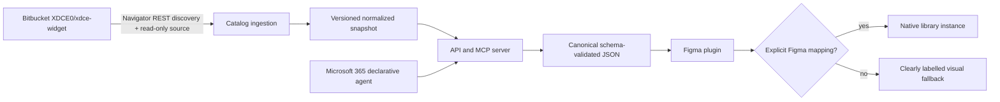

# Architecture

## Packages and applications

- `packages/prototype-schema`: versioned document model, JSON Schema, runtime validation and tree traversal.
- `packages/xdce-catalog`: normalized catalog model, Navigator ingestion, provenance, lookup and missing-requirement questions.
- `apps/mcp-server`: dependency-free Node HTTP service exposing REST and MCP JSON-RPC tools.
- `apps/figma-plugin`: JSON import UI, render-plan validation, Auto Layout renderer and explicit native/fallback distinction.
- `apps/m365-agent`: declarative-agent instructions, API plugin and OpenAPI contract with deployment placeholders.

The canonical boundary is `PrototypeDocument` version `1.0.0`. Catalog validation and schema validation are separate on purpose: schema validation proves document shape; generation proves component IDs and important options came from the loaded catalog.
